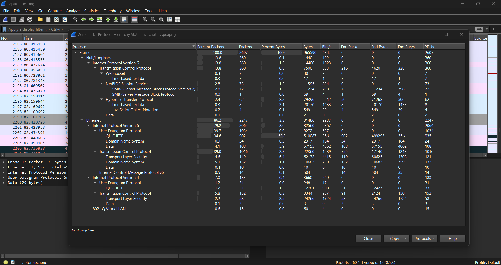
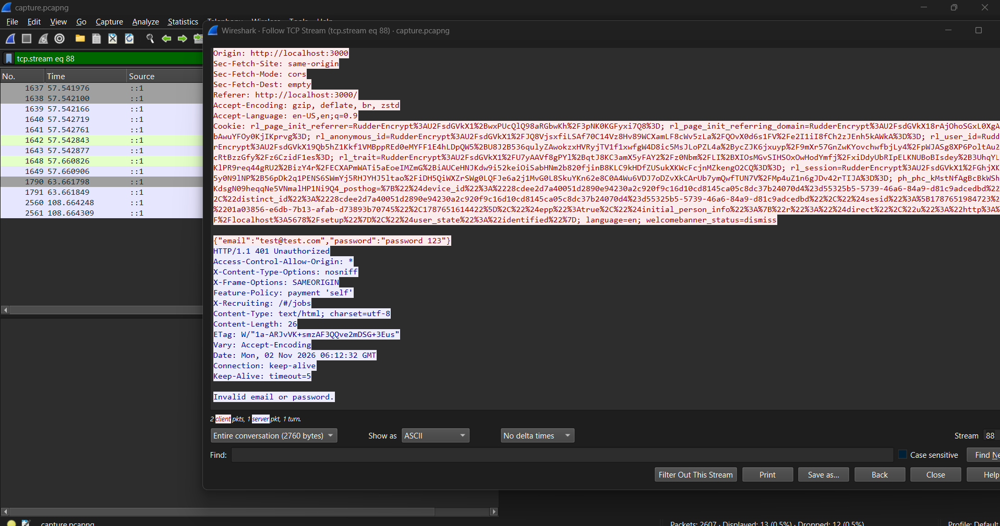
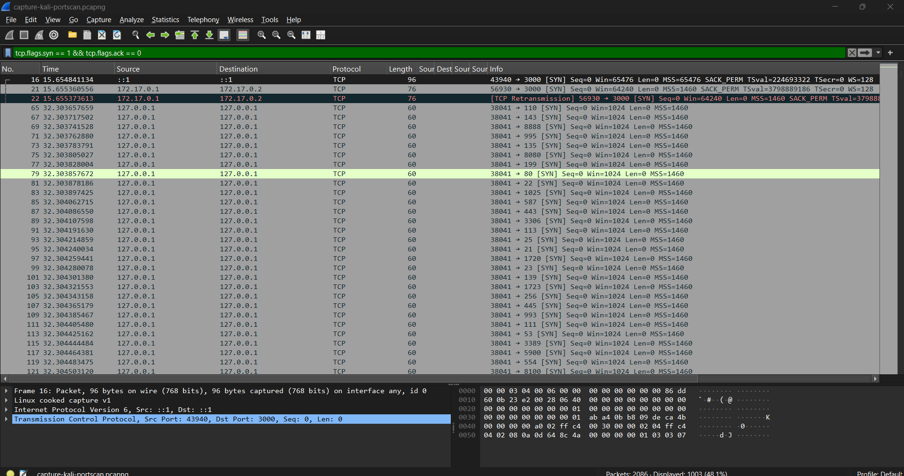
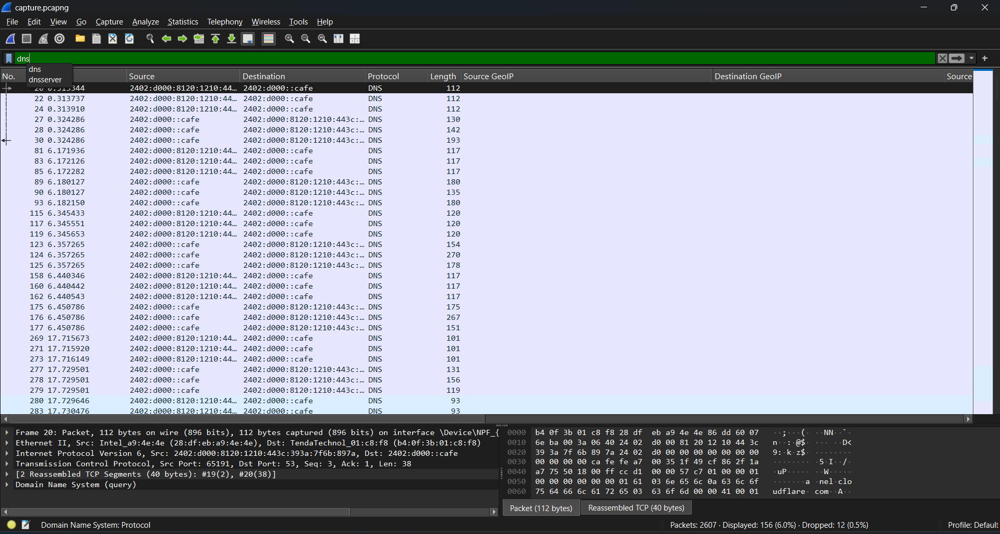

# 🔐 Network Security Analysis

**Analysing network traffic in a controlled lab with Wireshark to identify protocols, suspicious patterns, and security concerns, and documenting them in a defensive analysis report**

        

---

## 📌 Project Overview

This is my **Task 2 — Network Security Analysis** submission for the SWYNEX Technologies internship.

The task was to analyse network traffic in a controlled environment using Wireshark, identify protocols, suspicious patterns and potential security concerns, and submit a defensive analysis report.

I captured my own lab traffic (normal browsing, a failed login to a local **OWASP Juice Shop** instance, and a ping test), then ran a separate **Nmap SYN scan** against my own loopback interface from **Kali Linux** to see what a port scan looks like on the wire. Everything was tested only on machines I own and control.

---

## 🎯 Objectives

- Capture traffic in a safe, controlled lab with Wireshark.
- Identify the protocols in use with Protocol Hierarchy, Conversations and display filters.
- Find suspicious patterns: cleartext credentials, DNS behaviour, and port scanning.
- Document each finding with evidence, risk level, and defensive recommendations.
- Practice professional security reporting.

⚠️ **Important:** All traffic was generated on my own machines against a local, self-hosted application. No external or unauthorized systems were tested.

---

## 🛡️ Lab Architecture

```
Capture 1: Windows host
Browser  ->  OWASP Juice Shop (http://localhost:3000)
                  |
         Wireshark records loopback + network traffic  ->  capture.pcapng

Capture 2: Kali Linux
Nmap SYN scan  ->  127.0.0.1 (own loopback only)
                  |
         Wireshark records the scan  ->  capture-kali-portscan.pcapng
```

---

## ⚙️ Lab Configuration

| 🧩 Component | ⚙️ Configuration |
|---|---|
| 🖥️ Capture host | Windows with Wireshark |
| 🐉 Scan host | Kali Linux |
| 🎯 Target | OWASP Juice Shop (`http://localhost:3000`) and own loopback interface |
| 🧰 Tools | Wireshark, Nmap, Python 3 + Scapy |
| 📦 Main capture | 2,607 packets, about 112 seconds, 2 November 2026 |

---

## 🔎 Findings Summary

| # | Finding | Severity (real network) |
|---|---|---|
| 1 | Login credentials and cookies sent in **cleartext HTTP** | 🔴 High |
| 2 | **TCP SYN port scan** pattern (1,000 probes, fixed source port, about 30 µs apart) | 🔴 High |
| 3 | Unencrypted DNS, mostly over TCP, plus a **WPAD** lookup | 🟠 Medium |
| 4 | Local SMB and IPv6 neighbour discovery traffic | 🔵 Informational |

Full details for each finding — evidence, why it matters, recommended mitigation — are in the **[full report](report/Network-Security-Analysis-Report.md)**.

---

## 📊 Traffic Overview

| Protocol | Share of packets | Note |
|---|---|---|
| QUIC | about 36% (52.8% of bytes) | Encrypted, counted but not inspected |
| TLS | 6.8% | Encrypted web traffic |
| DNS | 6.0% | 78 queries, 25 unique names |
| HTTP (cleartext) | 2.4% | Local Juice Shop traffic only |
| SMB / SMB2 | 2.8% | Loopback, port 445 |
| ICMPv6 | 0.5% | Ping test and neighbour discovery |

---

## 📸 Evidence Screenshots

**Protocol Hierarchy**



**Finding 1 — Cleartext credentials (Follow TCP Stream)**



**Finding 2 — TCP SYN port scan**



**Finding 3 — DNS queries**



---

## 🪜 Methodology

**Step 1 — Capture**
Recorded traffic in Wireshark while browsing, logging in to Juice Shop with a deliberately wrong password, and running a short ping test.

**Step 2 — Protocol overview**
Used **Statistics → Protocol Hierarchy** to see which protocols dominate the capture and where the bytes go.

**Step 3 — Credential exposure**
Found the login request with `http.request.method == "POST"`, then used **Follow → TCP Stream** (`tcp.stream eq 88`) to show the email, password and cookies readable in plain text.

**Step 4 — DNS review**
Applied the `dns` filter, counted queries and record types, and checked for tunnelling signs (very long names, random sub-domain bursts). Flagged the WPAD lookup.

**Step 5 — Port scan detection**
Ran an Nmap SYN scan against my own loopback from Kali, captured it, and used `tcp.flags.syn == 1 && tcp.flags.ack == 0` to expose the pattern: one source, many different destination ports, bare SYN packets sent microseconds apart.

**Step 6 — Cross-check and report**
Re-counted key numbers with Python/Scapy scripts, then wrote the defensive report with risk ratings and recommendations.

---

## 💡 What I Learned

### 1. Cleartext HTTP exposes everything
Following a single TCP stream was enough to read a login request, including the password and session cookies.

### 2. A port scan has a clear fingerprint
Fixed source port, a different destination port in every packet, bare SYNs, tiny gaps between packets, and no completed connections.

### 3. "Normal" background traffic still needs review
DNS over TCP, a WPAD lookup and local SMB traffic are not attacks, but each one is attack surface worth checking.

### 4. Encrypted traffic limits visibility
About 43% of packets (QUIC and TLS) could only be counted, not read. Metadata such as DNS and connection patterns matters for defenders.

### 5. Protect your own evidence
Raw captures contain personal data (IP addresses, MAC addresses, browsing history), so I sanitized the published capture.

---

## 📁 Repository Structure

```
README.md
report/        Full defensive analysis report
screenshots/   Wireshark evidence for each finding
captures/      Sanitized lab capture + port scan capture
scripts/       Python/Scapy scripts used to cross-check and sanitize
```

---

## 🔁 Reproduce the Analysis

1. Install [Wireshark](https://www.wireshark.org/) and open a file from `captures/`.
2. Useful display filters:
   - `http` — cleartext Juice Shop traffic
   - `http.request.method == "POST"` — the login request, then **Follow → TCP Stream**
   - `dns` — name lookups
   - `tcp.flags.syn == 1 && tcp.flags.ack == 0` — SYN-only packets (scan pattern)
3. Optional: `pip install scapy` and run the scripts in `scripts/`.

📝 **Note on the capture files:** the raw capture also contained personal browsing traffic, so it is not published. `scripts/sanitize_pcap.py` keeps only the lab traffic to `localhost:3000`.

---

## 🔐 Security & Ethical Use

This analysis was performed for **educational purposes only**, on traffic generated by me, against an intentionally vulnerable training application (OWASP Juice Shop) and my own loopback interface. No real or third-party systems were scanned or attacked.

---

## 🔗 Tools & Resources

- **Wireshark:** https://www.wireshark.org
- **Nmap:** https://nmap.org
- **OWASP Juice Shop:** https://owasp-juice.shop
- **Scapy:** https://scapy.net

---

## 👤 Author

**Mubassir**
Security Intern, SWYNEX Technologies — Task 2

---

## 📌 Project Information

**Program:** SWYNEX Technologies Internship | **Task:** 2 — Network Security Analysis | **Repository:** GitHub
